# Project Report: Smart Campus Solutions

**Unified Web Platform for Academic Administration, Facilities Management, Campus Security, and Extracurricular Student Engagement**

---

## 1. Abstract

Higher-education institutions frequently struggle with fragmented administrative silos, disjointed communication channels, manual paper-based workflows, and legacy software systems that do not interoperate. This report presents the design, architectural formulation, algorithmic implementations, and testing outcomes of **Smart Campus Solutions**—a cohesive, enterprise-scale web platform consolidating five mission-critical campus functional areas into a real-time, responsive single-page web environment.

The system encompasses:
1. **M1. Smart Classroom Availability and Timetable Assistant**
2. **M2. Digital Lost-and-Found Management System**
3. **M3. QR-Based Classroom Attendance and Visitor Management**
4. **M4. Campus Maintenance and Complaint Reporting Application**
5. **M5. Smart College Event and Activity Notification System**

The solution is developed using a full-stack JavaScript architecture comprising **Node.js 18+**, **Express 4**, **MongoDB / Mongoose 8**, **Socket.io**, and **React 18 + Vite** with **Tailwind CSS**. It incorporates anti-proxy dynamic QR attendance verification (HMAC-SHA256), composite heuristic lost-and-found matching (Jaccard similarity and string distance), automated SLA escalation daemons, and reactive event waitlisting algorithms.

---

## 2. Problem Statement

Modern university campuses house thousands of students, faculty members, administrative staff, security personnel, and facilities teams operating across distributed buildings and lecture complexes. However, institutional operations remain hindered by persistent pain points:
- **Classroom Utilization Inefficiencies**: Students waste time hunting for empty rooms for ad-hoc study groups, while faculty and administrators face double-booking conflicts due to static, uncoordinated timetable spreadsheets.
- **Lost Property Friction**: Items misplaced across campus are handled via unstructured WhatsApp groups, physical noticeboards, or lost-property drawers with low retrieval rates and no verification of ownership.
- **Attendance Proxying & Administrative Burden**: Traditional paper roll-calls waste up to 15% of instructional time, while static QR codes or physical signatures suffer from rampant buddy-punching and proxy marking.
- **Delayed Facilities Maintenance**: Broken air conditioning units, faulty projectors, and electrical hazards go unaddressed for weeks because students have no centralized ticketing system with guaranteed service-level agreements (SLAs).
- **Fragmented Event Communication**: Extracurricular activities, workshops, and hackathons are lost in generic email blasts, causing low student turnout or unmanaged venue overcrowding without waitlisting capabilities.

---

## 3. Objectives

The primary engineering objectives of the Smart Campus Solutions platform are:
1. **Unify Campus Micro-Operations**: Provide a single authenticated portal with role-based access control (RBAC) supporting `admin`, `faculty`, `student`, `security`, and `maintenance` personnel.
2. **Automate Spatial Allocation**: Eliminate scheduling conflicts with a deterministic clash detection engine and provide real-time classroom occupancy status boards with forward-looking time simulation.
3. **Streamline Property Recovery**: Implement an intelligent heuristic scoring algorithm that automatically pairs reciprocal lost and found reports and notifies involved parties.
4. **Enforce Attendance Integrity**: Deploy a dynamic, anti-proxy QR attendance system that refreshes cryptographic tokens every 20 seconds, supports optional geofencing boundaries, and synchronizes live attendee lists over WebSockets.
5. **Institute Transparent Maintenance Accountability**: Establish a rigid, linear ticket lifecycle with automatic SLA deadline tracking and cron-driven escalation for neglected campus infrastructure issues.
6. **Democratize Extracurricular Coordination**: Deliver an event management engine with automated capacity enforcement, instant waitlist promotions, and multi-stage reminders.

---

## 4. Scope

The scope of this release encompasses the complete autonomous implementation of the web platform:
- **Web Clients**: Desktop, tablet, and mobile-responsive single-page application built with React 18, Vite, and Tailwind CSS.
- **Backend API**: RESTful JSON service with WebSocket streaming built with Express and Socket.io.
- **Data Persistence**: Document database built on MongoDB with indexing, referential integrity checks, and validation schemas.
- **Operating Constraints**: Fully autonomous operation requiring zero external cloud dependencies (local disk image storage, local MongoDB database, and console/Ethereal email fallback).

---

## 5. Existing vs. Proposed System

| Dimension | Existing Campus Systems | Proposed Smart Campus Solutions Platform |
| :--- | :--- | :--- |
| **System Architecture** | Disparate standalone tools (Google Sheets, WhatsApp, paper registers) | Unified monorepo web platform with centralized database and shared event bus |
| **Room Availability** | Static printed schedules taped to doors; manual inspection | Real-time live status board (`Available`, `Occupied`, `Upcoming`) + 60s auto-refresh + time simulator |
| **Classroom Scheduling** | Prone to human double-booking; manual conflict resolution | Algorithm B clash detection enforcing $O(1)$ overlap checks and blocking dual-booking of faculty |
| **Lost & Found** | Physical notice boards; unstructured social media posts | Algorithm G automated composite matching ($\ge 50\%$ score threshold) with instant bilateral alerts |
| **Attendance Verification** | Paper calling or static QR codes vulnerable to remote forwarding | Algorithm D dynamic 20s HMAC-SHA256 rotating QR codes with geofencing validation and duplicate blocks |
| **Facilities Maintenance** | Informal verbal complaints; zero accountability or timelines | Algorithm H strict forward status pipeline with automated 15-minute cron SLA breach escalation |
| **Event Coordination** | Unmanaged registration forms resulting in room overcrowding | Algorithm I capacity-bounded registrations with automatic waitlist queueing and promotion on cancellation |
| **Security & Auditing** | Manual paper visitor logs at security gates | Algorithm F 10-character unique visitor pass QR scanner with 3-state finite state machine |

---

## 6. System Architecture

The application adopts a decoupled client-server architecture communicating over HTTP REST APIs and duplex WebSocket connections.

```mermaid
flowchart TD
    subgraph Client ["Client Layer (React 18 + Vite + Tailwind CSS)"]
        UI["Tailwind Responsive Single Page Application"]
        Router["React Router 6 (30+ Protected Routes)"]
        State["Zustand Store (Auth, Notifications, Theme)"]
        AxiosClient["Axios Interceptor (JWT Bearer Injection)"]
        SocketClient["Socket.io Client (Real-time duplex events)"]
        Scanner["html5-qrcode Scanner (Attendance & Visitor Pass)"]
    end

    subgraph Gateway ["Security & Middleware Gateway (Express 4)"]
        HelmetMW["Helmet Security Headers"]
        CorsMW["CORS Configuration"]
        RateLimiter["express-rate-limit (Global & Auth Limiters)"]
        Sanitizer["NoSQL Injection Sanitizer"]
        AuthMW["JWT Verification Middleware (auth.js)"]
        RbacMW["Role Authorization Middleware (rbac.js)"]
        AuditMW["Audit Logging Middleware (audit.js)"]
        MulterMW["Multer Local Disk Upload Handler"]
    end

    subgraph Core ["Backend Business Logic Services"]
        M1["M1 Controller (Clash Detection, Status Board, Free Room Finder)"]
        M2["M2 Controller & Algorithm G Matching Engine"]
        M3["M3 Controller (HMAC Attendance Crypto, Visitor Pass FSM)"]
        M4["M4 Controller & Algorithm H SLA Escalation Engine"]
        M5["M5 Controller & Algorithm I Waitlist Promotion Engine"]
        CronSrv["node-cron Daemons (15m SLA Cron, 5m Event Reminder Cron)"]
        NotifySrv["Unified Notification Service (DB + Socket.io + Nodemailer)"]
    end

    subgraph Storage ["Persistence & Storage Layer"]
        Mongo["MongoDB Database (14 Mongoose Schemas & Indexes)"]
        Disk["Local Disk File System (/server/uploads)"]
    end

    UI --> Router
    Router --> State
    State --> AxiosClient
    State --> SocketClient
    UI --> Scanner

    AxiosClient -->|HTTP REST Requests| HelmetMW
    HelmetMW --> CorsMW --> RateLimiter --> Sanitizer --> AuthMW --> RbacMW --> AuditMW
    AuditMW --> Core
    MulterMW --> Disk

    SocketClient <-->|WebSocket Events (attendance:marked, notify:new)| NotifySrv

    Core --> Mongo
    CronSrv --> Core
    NotifySrv --> Mongo
```

---

## 7. Entity-Relationship (ER) Diagram

The system database model comprises 14 Mongoose collections engineered with compound indexes, foreign key references, and strict schema validation rules.

```mermaid
erDiagram
    User ||--o{ Timetable : "teaches"
    User ||--o{ RoomBooking : "requests"
    User ||--o{ LostFoundItem : "reports"
    User ||--o{ Claim : "claims"
    User ||--o{ AttendanceSession : "conducts"
    User ||--o{ AttendanceRecord : "attends"
    User ||--o{ Visitor : "hosts"
    User ||--o{ Complaint : "raises"
    User ||--o{ Complaint : "assigned_to"
    User ||--o{ Event : "organizes"
    User ||--o{ EventRegistration : "registers"
    User ||--o{ Notification : "receives"
    User ||--o{ AuditLog : "initiates"

    Classroom ||--o{ Timetable : "hosts_slot"
    Classroom ||--o{ RoomBooking : "booked_for"
    Classroom ||--o{ AttendanceSession : "session_venue"

    LostFoundItem ||--o{ Claim : "has_claims"
    LostFoundItem ||--o| LostFoundItem : "matched_with"

    AttendanceSession ||--o{ AttendanceRecord : "records"

    Event ||--o{ EventRegistration : "has_registrations"

    User {
        ObjectId _id PK
        string name
        string email UK
        string password
        string role "admin|faculty|student|security|maintenance"
        string department
        int year
        string rollNo UK
        string phone
        string avatar
        boolean isActive
        string[] clubs
    }

    Classroom {
        ObjectId _id PK
        string roomNo UK
        string building
        int floor
        int capacity
        string type "lecture|lab|seminar"
        string[] facilities
        boolean isActive
    }

    Timetable {
        ObjectId _id PK
        ObjectId classroom FK
        string subject
        ObjectId faculty FK
        string department
        int year
        string section
        int dayOfWeek "0-6"
        string startTime "HH:mm"
        string endTime "HH:mm"
        string status "active|cancelled"
    }

    RoomBooking {
        ObjectId _id PK
        ObjectId classroom FK
        ObjectId requestedBy FK
        date date
        string startTime "HH:mm"
        string endTime "HH:mm"
        string purpose
        int expectedStrength
        string status "pending|approved|rejected|cancelled"
        string adminRemark
    }

    LostFoundItem {
        ObjectId _id PK
        string type "lost|found"
        string title
        string category
        string description
        date dateOccurred
        string location
        string[] images
        ObjectId reportedBy FK
        string status "reported|matched|claimed|returned|closed"
        ObjectId matchedWith FK
        string[] keywords
    }

    Claim {
        ObjectId _id PK
        ObjectId item FK
        ObjectId claimant FK
        string proofDescription
        string[] proofImages
        string status "pending|approved|rejected"
        ObjectId verifiedBy FK
        string remark
    }

    AttendanceSession {
        ObjectId _id PK
        ObjectId faculty FK
        string subject
        string department
        int year
        string section
        ObjectId classroom FK
        date startedAt
        date endsAt
        boolean isActive
        string qrSecret
        int qrRefreshSeconds
        boolean geoRequired
    }

    AttendanceRecord {
        ObjectId _id PK
        ObjectId session FK
        ObjectId student FK
        date markedAt
        string method "qr|manual"
        string status "present|absent|late"
    }

    Visitor {
        ObjectId _id PK
        string name
        string phone
        string email
        string purpose
        ObjectId personToMeet FK
        string idProofType
        string idProofNumber
        string passCode UK
        string status "expected|checked_in|checked_out|cancelled"
        date checkInAt
        date checkOutAt
    }

    Complaint {
        ObjectId _id PK
        string ticketId UK
        ObjectId raisedBy FK
        string category
        string building
        string room
        string description
        string priority "low|medium|high|critical"
        string[] images
        string status "submitted|assigned|in_progress|resolved|closed"
        ObjectId assignedTo FK
        date slaDueAt
        boolean escalated
    }

    Event {
        ObjectId _id PK
        string title
        string category
        string venue
        date startAt
        date endAt
        ObjectId organizer FK
        int capacity
        date registrationDeadline
        string[] targetDepartments
        int[] targetYears
        boolean isCancelled
    }

    EventRegistration {
        ObjectId _id PK
        ObjectId event FK
        ObjectId user FK
        string status "registered|waitlisted|cancelled|attended"
        date checkedInAt
    }

    Notification {
        ObjectId _id PK
        ObjectId user FK
        string title
        string message
        string type
        string link
        boolean isRead
    }

    AuditLog {
        ObjectId _id PK
        ObjectId actor FK
        string action
        string entity
        ObjectId entityId
        string ip
    }
```



---

## 8. Detailed Module Descriptions & Data Flows

### M1. Smart Classroom Availability and Timetable Assistant

#### Functional Overview
M1 serves as the spatial nervous system of the campus. It aggregates recurring departmental course schedules with ad-hoc event bookings to provide an authoritative, conflict-free view of room availability.

#### Core Algorithms
- **Algorithm A: Room Status Evaluation**:
  Given any target time $T$ and weekday $D$:
  1. Inspect active `Timetable` slots where `dayOfWeek == D` and `startTime <= T < endTime`.
  2. Inspect approved `RoomBooking` records for the corresponding calendar date where `startTime <= T < endTime`.
  3. If any match exists, status is `Occupied`. Identify the class or booking name and compute `freeUntil`.
  4. If no current match exists, locate the earliest upcoming slot starting after $T$. If this slot begins within 30 minutes, status is `Upcoming`; otherwise, status is `Available`.
- **Algorithm B: Clash Detection**:
  Blocks creation of any schedule entry or booking where:
  $$\text{existing.start} < \text{new.end} \quad \land \quad \text{new.start} < \text{existing.end}$$
  The validation runs across both the requested `classroom` and the assigned `faculty` member to guarantee that instructors cannot be scheduled in two locations simultaneously.
- **Algorithm C: Free Room Finder**:
  Filters out any room possessing a clash within the query window $[T_{\text{start}}, T_{\text{end}}]$, respects minimum capacity and facility filters, and sorts results ascending by capacity ($\text{capacity} - \text{requestedCapacity} \ge 0$) to optimize facility utilization.

---

### M2. Digital Lost-and-Found Management System

#### Functional Overview
M2 establishes an intelligent, searchable lost-and-found repository replacing disorganized bulletin boards. It enables students and security guards to post item records with photos and automates ownership verification.

#### Core Algorithm
- **Algorithm G: Heuristic Match Scoring**:
  Upon the creation of any new item, the system searches the reciprocal collection (i.e. `lost` vs `found`) with status `reported` and computes a composite score $S \in [0, 100]$:
  $$S = S_{\text{cat}} + S_{\text{kw}} + S_{\text{loc}} + S_{\text{date}}$$
  - **Category Match ($S_{\text{cat}}$)**: $40$ points if `itemA.category == itemB.category`, else $0$.
  - **Keyword Jaccard Similarity ($S_{\text{kw}}$)**: Up to $25$ points:
    $$J(A, B) = \frac{|T_A \cap T_B|}{|T_A \cup T_B|} \times 25$$
    where $T_A, T_B$ are alphanumeric tokens derived from title and description after filtering standard English stopwords.
  - **Location String Proximity ($S_{\text{loc}}$)**: Up to $20$ points using Levenshtein distance ratio.
  - **Date Proximity ($S_{\text{date}}$)**: Up to $15$ points:
    $$S_{\text{date}} = \max\left(0, 15 \times \left(1 - \frac{|\Delta\text{days}|}{7}\right)\right)$$
  - **Match Trigger**: If $S \ge 50$, the top 5 candidates are saved to `matchedWith`, an automated in-app notification is fired to both users, and an administrative confirmation panel displays the match.

---

### M3. QR-Based Classroom Attendance and Visitor Management

#### Functional Overview
M3 provides dual authentication pipelines: one for high-throughput academic attendance tracking and another for campus perimeter security and visitor authorization.

#### Core Algorithms
- **Algorithm D: Dynamic Anti-Proxy QR Attendance**:
  - The faculty session holds a 32-byte cryptographic `qrSecret`.
  - Every 20 seconds, a time-step token is computed:
    $$\text{token} = \text{truncate}_{16}\left(\text{HMAC-SHA256}\left(\text{qrSecret}, \text{sessionId} + \text{":"} + \left\lfloor\frac{\text{now}}{20}\right\rfloor\right)\right)$$
  - The client displays the QR payload `{"sid": sessionId, "token": token}`.
  - Upon student scan, the server validates the submitted token against both the current window ($\lfloor t/20 \rfloor$) and previous window ($\lfloor t/20 \rfloor - 1$).
  - Duplicate submissions are rejected by a unique compound database index:
    $$\text{CREATE UNIQUE INDEX} (\text{session}, \text{student})$$
  - If geofencing is enabled, the distance between the student's coordinates and the classroom coordinates is computed via the Haversine formula and must satisfy $\text{distance} \le \text{radiusMeters}$.
- **Algorithm F: Visitor Pass Finite State Machine**:
  Each visitor is provisioned with a 10-character uppercase alphanumeric code (e.g., `VIS-ABC1234XYZ`). Security checkpoint scans execute the following state transitions:
  ```text
  [expected] ----(Scan 1)----> [checked_in] ----(Scan 2)----> [checked_out] ----(Scan 3)----> [HTTP 400 "Pass already used"]
  ```

---

### M4. Campus Maintenance and Complaint Reporting Application

#### Functional Overview
M4 provides facilities management workflows for student dorms, academic blocks, and infrastructure services. It enforces accountability through service-level agreements (SLAs), automatic cron-driven escalations, and satisfaction feedback loops.

#### Core Algorithms
- **Algorithm H: SLA Calculation & Background Escalation**:
  Upon creation, the SLA target resolution date is assigned based on priority:
  $$\text{slaDueAt} = \text{createdAt} + \Delta t_{\text{priority}}$$
  where $\Delta t_{\text{critical}} = 4\text{ hours}, \Delta t_{\text{high}} = 24\text{ hours}, \Delta t_{\text{medium}} = 72\text{ hours}, \Delta t_{\text{low}} = 120\text{ hours}$.
- A background cron running every 15 minutes queries:
  $$\text{status} \notin \{\text{"resolved"}, \text{"closed"}\} \quad \land \quad \text{slaDueAt} < \text{Now}() \quad \land \quad \text{escalated} == \text{false}$$
  Matching tickets are updated with `escalated = true`, logged to the ticket timeline, and dispatched to administrators as high-priority alert notifications.
- **Strict Linear Status Pipeline**:
  State transitions must strictly advance forward:
  $$\text{submitted} \longrightarrow \text{assigned} \longrightarrow \text{in\_progress} \longrightarrow \text{resolved} \longrightarrow \text{closed}$$
  Closing a ticket requires either administrative sign-off or the reporting student submitting a 1-to-5 star rating and feedback comment.

---

### M5. Smart College Event and Activity Notification System

#### Functional Overview
M5 coordinates campus life, cultural fests, workshops, and student club activities. It manages limited venue seating, enforces registration deadlines, and promotes waitlisted students automatically upon cancellations.

#### Core Algorithms
- **Algorithm I: Capacity & Waitlist Engine**:
  When a student registers:
  1. If `activeRegistrations.length < event.capacity`, status is assigned as `registered`.
  2. If the venue is full, status is assigned as `waitlisted`.
  3. When an existing `registered` student cancels, the system automatically finds the earliest waitlisted entry:
     $$\text{Candidate} = \arg\min_{\text{createdAt}} \{\text{EventRegistration} \mid \text{event} = E \land \text{status} = \text{"waitlisted"}\}$$
  4. The candidate is immediately updated to `registered`, and the notification service sends them an in-app and email confirmation notice.
- **Algorithm J: Automated Reminders**:
  A cron daemon evaluates upcoming events every 5 minutes. When an event is within 24 hours (and `reminded24 == false`) or within 1 hour (and `reminded1 == false`), multi-channel notifications are dispatched to all confirmed registrants, and the reminder flag is set to prevent duplicate alerts.

---

## 9. Technologies Used & Rationale

| Layer / Library | Technology | Architectural Rationale |
| :--- | :--- | :--- |
| **Runtime Environment** | Node.js 18+ (ES Modules) | High-performance asynchronous non-blocking I/O ideal for WebSocket streaming, background crons, and REST routing. |
| **Backend Framework** | Express 4.19 | Mature, unopinionated web framework with extensive middleware ecosystem for routing, security, and validation. |
| **Database** | MongoDB & Mongoose 8.3 | Flexible document model supporting polymorphic schemas (e.g. complaint timelines, audit logs) with ACID transaction support. |
| **Real-time Bus** | Socket.io 4.7 | Duplex WebSocket protocol with fallback transports, room multiplexing (`user:<id>`), and event synchronization. |
| **Frontend Framework** | React 18 & Vite 5.2 | Component-driven declarative UI with rapid hot module replacement (HMR) and optimized production tree-shaking. |
| **Styling Engine** | Tailwind CSS 3.4 | Utility-first responsive CSS framework enabling consistent dark/light themes and high UI density without stylesheet bloat. |
| **State Management** | Zustand 4.5 | Lightweight, unopinionated state management without boilerplate reducers or context re-rendering penalties. |
| **Client Routing** | React Router 6.22 | Declarative client-side routing with nested layouts and role-based route protection guards. |
| **Document Export** | PDFKit & json2csv | Server-side binary PDF generation and streaming CSV formatting for administrative attendance records. |
| **Task Scheduling** | node-cron 3.0 | In-process daemon executing deterministic cron schedules for SLA escalations and event reminders. |

---

## 10. Comprehensive Verification & Testing Results

The Smart Campus Solutions platform was subjected to rigorous end-to-end verification against the 10 acceptance criteria defined in the technical specification.

| Test ID | Module | Test Scenario & Input Action | Expected Behavioral Outcome | Pass Criteria | Code Implementation Reference |
| :---: | :---: | :--- | :--- | :--- | :--- |
| **TC-01** | **M1** | Faculty requests booking for `LHC-101` on Monday 09:00–10:00 when an active Timetable slot or approved booking already exists. | Server rejects the booking with `HTTP 409 Conflict` and outputs a descriptive error message naming the conflicting entry. | Double-booking blocked; conflict returned in payload; no record created. | `server/controllers/roomBookingController.js`, `server/controllers/timetableController.js` |
| **TC-02** | **M1** | User searches for free rooms for Tuesday 10:00–11:00 with minimum capacity 80 and projector facility. | Returns only unbooked rooms meeting capacity and facilities, ordered by smallest sufficient capacity. | Occupied rooms excluded; rooms sorted ascending by capacity ($80 \le \text{capacity} \le 120$). | `server/controllers/roomBookingController.js` (`getFreeRooms`) |
| **TC-03** | **M3** | Student attempts to mark attendance using an expired QR token ($>20\text{s}$) or submits a second scan for the same session. | Expired token returns `HTTP 400 Bad Request`; duplicate scan attempt returns `HTTP 409 Conflict`. | Invalid tokens rejected; compound database index prevents duplicate attendance records. | `server/controllers/attendanceController.js`, `server/services/attendanceCrypto.js` |
| **TC-04** | **M3** | Student successfully scans an active dynamic attendance QR code while faculty has the Live Attendance screen open. | Faculty client receives WebSocket event `attendance:marked` and renders the student's name in real-time. | Real-time UI update occurs within 500ms without requiring manual browser reload. | `server/services/socket.js`, `client/src/pages/m3_attendance/FacultyLiveClass.jsx` |
| **TC-05** | **M3** | Security scans a visitor QR pass: First scan at entry, second scan at exit, third scan afterwards. | Scan 1 sets `checked_in`; Scan 2 sets `checked_out`; Scan 3 rejects with error "Pass already used". | Exact 3-state finite state machine transitions observed; timestamps recorded. | `server/controllers/visitorController.js` (`scanVisitorPass`) |
| **TC-06** | **M2** | User reports lost item "Black Dell Laptop" in "CS Lab 1"; user reports found item "Dell Laptop Charger and Bag" in "CS Lab 1". | Algorithm G computes a match score $\ge 50\%$, saves suggestion, and notifies both owners. | Match candidate visible in "Suggested Matches" panel; notifications logged in DB and emitted over Socket.io. | `server/services/matchingService.js`, `server/controllers/lostFoundController.js` |
| **TC-07** | **M4** | Ticket `CMP-2026-0001` with `critical` priority (4h SLA) passes deadline without resolution. | 15-minute background SLA cron sets `escalated = true` and dispatches notification to admin. | Cron detects overdue ticket, sets `escalated = true`, updates timeline, and notifies administrator. | `server/services/slaCron.js`, `server/controllers/complaintController.js` |
| **TC-08** | **M5** | Event created with capacity 2. Three students register sequentially. Student 1 cancels registration. | Student 3 is initially marked `waitlisted`; upon Student 1's cancellation, Student 3 is auto-promoted to `registered`. | Registered count stays $\le 2$; Student 3 status updates to `registered` and receives confirmation alert. | `server/controllers/eventController.js` (`registerForEvent`, `cancelRegistration`) |
| **TC-09** | **M5** | User logs in as `student` and attempts to view admin pages or navigate directly to `/admin/users`. | Sidebar hides admin links; client router redirects student to `/dashboard` with an access denied toast. | Unauthorized navigation blocked; zero privilege escalation allowed in UI or REST API. | `client/src/components/layout/Sidebar.jsx`, `client/src/components/layout/ProtectedRoute.jsx` |
| **TC-10** | **M3** | Faculty or Administrator requests CSV or PDF export for an attendance session. | Browser downloads valid `attendance-<id>.csv` with header columns and formatted PDF document with attendance percentage. | Valid MIME types (`text/csv`, `application/pdf`) and accurate student attendance rows. | `server/controllers/attendanceController.js` (`exportAttendanceCSV`, `exportAttendancePDF`) |

---

## 11. Conclusion & Future Scope

### Conclusion
The **Smart Campus Solutions** platform successfully demonstrates that campus administrative fragmentation can be completely resolved through clean architectural integration. By deploying deterministic collision algorithms (M1), heuristic similarity matching (M2), cryptographically rotating tokens (M3), deterministic SLA cron pipelines (M4), and reactive capacity queues (M5), the system delivers an enterprise-grade, real-time operating environment for modern academic institutions. The application requires zero third-party cloud accounts to run, maintaining high data privacy, operational autonomy, and cost efficiency.

### Future Scope & Enhancements
1. **Edge Hardware IoT Integration**: Direct integration with hardware turnstiles and RFID/NFC smart cards for frictionless gate access.
2. **Computer Vision Lost-and-Found Matching**: Expanding Algorithm G to include deep visual feature embeddings using MobileNet or CLIP for image-to-image similarity matching.
3. **Automated Timetable Generation**: Implementing genetic algorithms or integer linear programming (ILP) solvers to generate semester-wide course timetables automatically based on professor availability, classroom capacity, and student curriculum tracks.
4. **Offline PWA Capabilities**: Introducing service worker caching and background synchronization to allow security personnel to log visitor passes during intermittent campus Wi-Fi outages.
